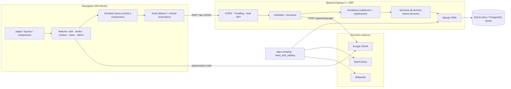
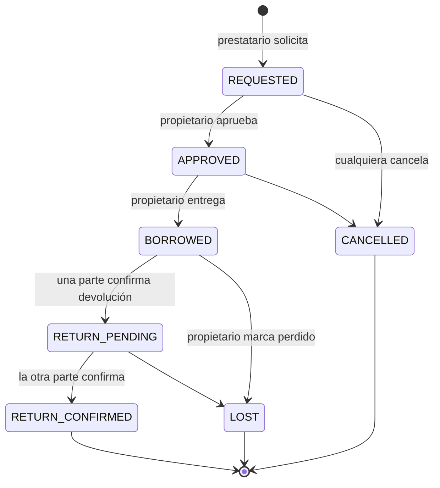
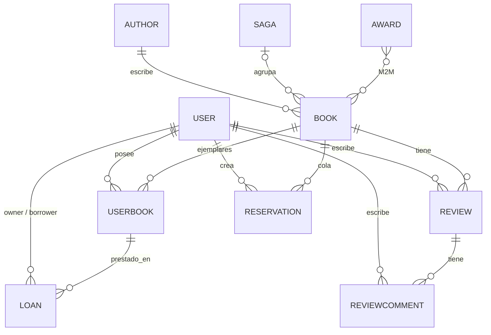
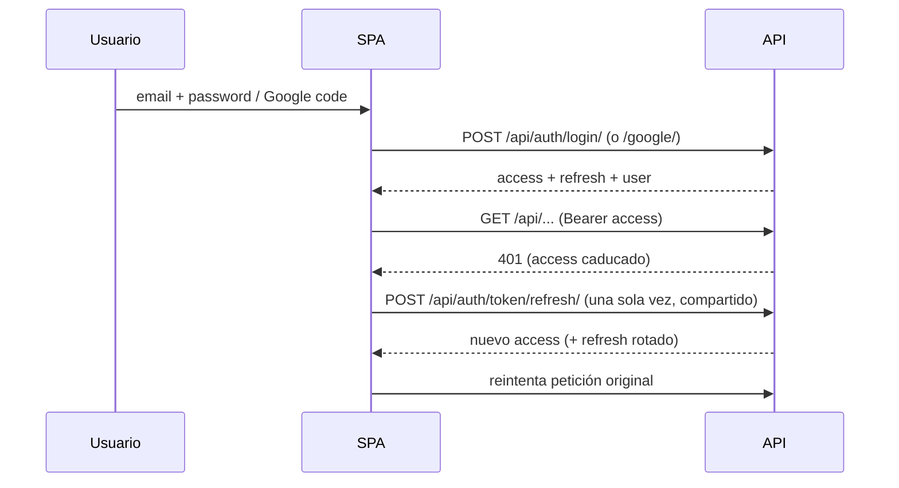

# Arquitectura

## Visión general

El frontend y el backend están completamente desacoplados: la única interfaz es la API REST documentada con OpenAPI (`/api/docs/`).

## Backend (`backend/apps`)

| App | Responsabilidad |
|---|---|
| `common` | Permisos (`IsAdminOrReadOnly`, `IsOwnerOrAdminOrReadOnly`), paginación, throttles, sanitización de texto. |
| `users` | Usuario con login por email, perfil (avatar, nombre, préstamos completados), registro, Google OAuth, reset de contraseña. |
| `authors`, `sagas`, `awards` | Entidades de catálogo con CRUD (escritura solo admin). |
| `books` | `Book` (rating medio y nº de reseñas calculados), `UserBook` (ejemplar físico), filtros y búsqueda full-text. |
| `reviews` | `Review` (1-5, varias por usuario) y `ReviewComment`. |
| `loans` | `Loan` con máquina de estados y doble confirmación de devolución; `Reservation` con cola por libro. |
| `scraping` | Clientes OpenLibrary/Wikipedia, importador idempotente y comando `seed_scifi_catalog`. |

### Capas

1. **Views (ViewSets):** autorización, filtros, paginación. Sin lógica de negocio compleja.
2. **Serializers:** validación de entrada y sanitización; representación de salida (campos calculados, `allowed_actions`).
3. **Services:** reglas de negocio transaccionales (`apps/loans/services.py`): transiciones de préstamo, cola de reservas, bloqueos de fila (`select_for_update`).
4. **Modelos:** restricciones de integridad en BD (CheckConstraint, UniqueConstraint parcial).

### Máquina de estados del préstamo

Las reservas solo se pueden crear cuando todos los ejemplares ofrecidos están prestados. Al solicitar un préstamo se respeta el orden de la cola (los ejemplares libres quedan reservados para los usuarios en cola) y la reserva del solicitante se consume y la cola se reordena.

Al aprobar un préstamo se cancelan automáticamente el resto de solicitudes pendientes sobre el mismo ejemplar. Si el propietario marca el ejemplar como perdido, este deja de estar disponible para préstamo. La restricción `unique_active_loan_per_copy` impide a nivel de BD dos préstamos activos sobre el mismo ejemplar.

## Modelo de datos

## Frontend (`frontend/src`)

| Carpeta | Contenido |
|---|---|
| `pages/` | Una por ruta (`/`, `/books`, `/books/:id`, `/authors`, `/sagas`, `/awards`, `/profile`, `/login`, `/register`, `/admin`…). |
| `features/` | Lógica por dominio: `auth` (contexto, rutas protegidas, Google), `books` (filtros, listados genéricos), `reviews`, `loans`, `admin` (CRUD genérico configurable). |
| `components/` | UI reutilizable con CSS Modules (PixelButton, Panel, BookCard, StarRating…). |
| `layouts/` | `MainLayout` (cabecera, efecto CRT) y `AuthLayout`. |
| `services/` | Axios (`api.js`), tokens, servicios REST por recurso. |
| `hooks/` | `useAuth`, `useResources` (queries/mutaciones + invalidación), `useDebounce`. |

### Autenticación en el cliente

## Decisiones clave

- **JWT con rotación y blacklist** para sesiones sin estado en el servidor de aplicación.
- **Compatibilidad PostgreSQL:** sin SQL específico del motor; la búsqueda detecta `connection.vendor` y usa full-text nativo en PostgreSQL.
- **`allowed_actions` calculado en el servidor:** el cliente no duplica reglas de negocio.
- **CRUD admin genérico** en el frontend, dirigido por configuración (`features/admin/config.js`).
- **Rate limiting** por defecto en DRF (anon/user/write/auth).
