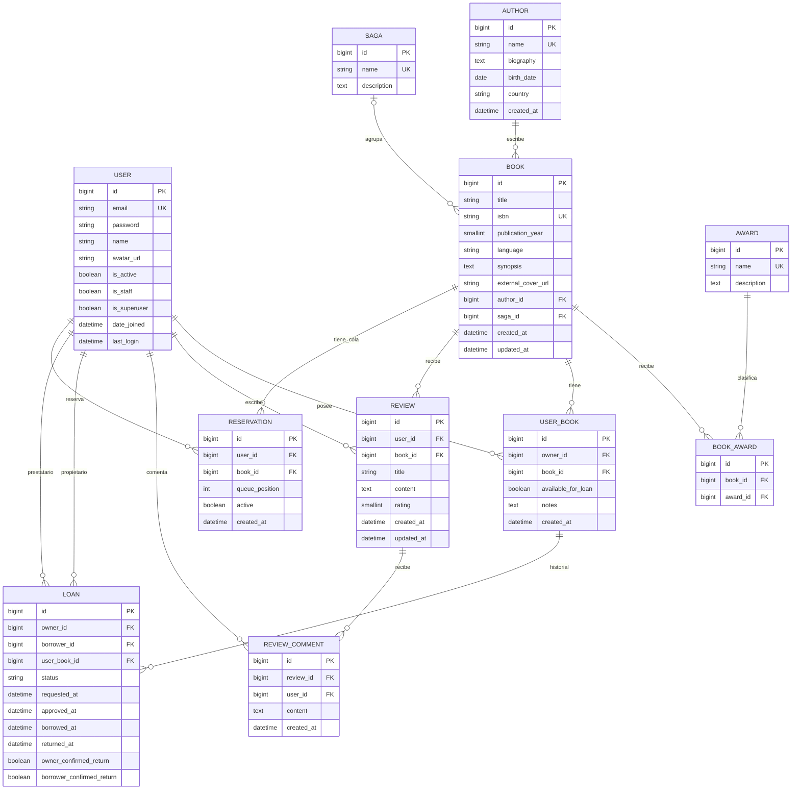

# ERD - Modelo entidad-relacion

## 1. Alcance y convenciones

Modelo del dominio definido por los modelos Django. Incluye la tabla intermedia
de premios; las tablas de autenticacion e infraestructura se inventarian al final.
El esquema se crea y actualiza con migraciones, no con este documento.

- `PK`: clave primaria; `FK`: clave foranea; `UK`: valor unico.
- Los identificadores propios son `BigAutoField` (entero autoincremental).
- `?` indica que la columna acepta NULL; un texto vacio no equivale a NULL.
- Los nombres SQL siguen el formato `app_model`.
- Las reglas `CASCADE`, `PROTECT` y `SET_NULL` descritas son politicas del ORM
  de Django; no deben interpretarse como clausulas SQL `ON DELETE` equivalentes.

## 2. Diagrama del dominio

La saga de un libro es opcional; las otras FK del diagrama son obligatorias.
Un libro tiene exactamente un autor en el modelo actual, no una relacion M:N.

## 3. Diccionario de datos

Todos los modelos de las siguientes tablas tienen `id` como PK.

### Usuario: `users_user`

| Campo | Tipo / regla |
|---|---|
| `email` | Email, max. 254, unico; identificador de login. |
| `name` | varchar(150), permite vacio. |
| `avatar_url` | URL, max. 500, permite vacio. |
| `is_staff`, `is_active` | boolean; valores iniciales false y true. |
| `date_joined` | datetime, instante actual por defecto. |
| `password` | varchar(128), hash heredado de `AbstractBaseUser`. |
| `last_login` | datetime?, heredado. |
| `is_superuser` | boolean, heredado de `PermissionsMixin`. |

El manager normaliza el email a minusculas al crear el usuario. `display_name`
y `role` son propiedades; `completed_loans` es un calculo de la API.
Los grupos y permisos usan tablas M:N auxiliares.

### Autor: `authors_author`

| Campo | Tipo / regla |
|---|---|
| `name` | varchar(200), unico. |
| `biography` | text, permite vacio. |
| `birth_date` | date?. |
| `country` | varchar(100), permite vacio. |
| `created_at` | datetime, automatico al crear. |

### Saga y premio: `sagas_saga`, `awards_award`

Ambas tablas tienen `name` varchar(200) unico y `description` text que permite
vacio. No tienen columnas de fechas. Sus serializers exponen `book_count`
como anotacion, no como dato persistido.

### Libro: `books_book`

| Campo | Tipo / regla |
|---|---|
| `title` | varchar(300), indexado. |
| `isbn` | varchar(20)?, unico; puede haber varios NULL. |
| `publication_year` | entero pequeno no negativo?, indexado. |
| `language` | varchar(10), permite vacio, indexado. |
| `synopsis` | text, permite vacio. |
| `external_cover_url` | URL, max. 500, permite vacio. |
| `author_id` | FK obligatoria a `authors_author`. |
| `saga_id` | FK? a `sagas_saga`. |
| `created_at`, `updated_at` | datetime automaticos de alta y ultima escritura. |

La API normaliza ISBN, acepta formatos de 10 o 13 caracteres y valida el ano
entre 1000 y el ano actual + 1. Estas validaciones no son todas restricciones
SQL: una escritura directa no pasa por los serializers.

### Premio de libro: `books_book_awards`

Tabla creada automaticamente para `Book.awards`. Contiene `id`, `book_id`
y `award_id`, con unicidad del par `(book_id, award_id)`. No almacena ano de
concesion, categoria ni datos adicionales del premio.

### Ejemplar: `loans_userbook`

| Campo | Tipo / regla |
|---|---|
| `owner_id` | FK a `users_user`. |
| `book_id` | FK a `books_book`. |
| `available_for_loan` | boolean, true por defecto; indica oferta del propietario. |
| `notes` | text, permite vacio. |
| `created_at` | datetime automatico. |

Un usuario puede tener varios ejemplares del mismo libro. `on_loan` se calcula
por existencia de prestamos comprometidos; no es una columna.

### Prestamo: `loans_loan`

| Campo | Tipo / regla |
|---|---|
| `owner_id`, `borrower_id` | FK a `users_user`, ambas obligatorias. |
| `user_book_id` | FK a `loans_userbook`. |
| `status` | varchar(20), indexado, `REQUESTED` por defecto. |
| `requested_at` | datetime automatico. |
| `approved_at`, `borrowed_at`, `returned_at` | datetime?. |
| `owner_confirmed_return`, `borrower_confirmed_return` | boolean, false por defecto. |

Estados: `REQUESTED`, `APPROVED`, `BORROWED`, `RETURN_PENDING`,
`RETURN_CONFIRMED`, `CANCELLED`, `LOST`.
Son choices del modelo; las transiciones se validan en los servicios.
`owner_id` se copia del propietario del ejemplar al solicitar el prestamo.
Esa igualdad entre tablas no tiene una restriccion SQL propia.

### Reserva: `loans_reservation`

| Campo | Tipo / regla |
|---|---|
| `user_id` | FK a `users_user`. |
| `book_id` | FK a `books_book`, no a un ejemplar. |
| `queue_position` | entero no negativo, 1 por defecto; servicio asigna posiciones desde 1. |
| `active` | boolean, true por defecto, indexado. |
| `created_at` | datetime automatico. |

No hay unicidad SQL de `(book_id, queue_position)`; el servicio mantiene la cola.
Cancelar conserva la fila con `active=false`.

### Resena: `reviews_review`

| Campo | Tipo / regla |
|---|---|
| `user_id`, `book_id` | FK obligatorias a usuario y libro. |
| `title` | varchar(200). |
| `content` | text. |
| `rating` | entero pequeno, entre 1 y 5. |
| `created_at`, `updated_at` | datetime automaticos. |

No hay unicidad de `(user_id, book_id)`: se permiten varias resenas del mismo
usuario sobre un libro.

### Comentario: `reviews_reviewcomment`

Contiene `review_id` (FK a resena), `user_id` (FK a usuario), `content` (text)
y `created_at` (datetime automatico). No tiene `updated_at`.

## 4. Integridad referencial y borrado

| Relacion | Politica Django |
|---|---|
| Libro -> autor | `PROTECT`: impide borrar un autor con libros. |
| Libro -> saga | `SET_NULL`: el libro permanece sin saga. |
| Libro <-> premio | Borrar cualquiera elimina asociaciones M:N. |
| Ejemplar -> usuario / libro | `CASCADE`. |
| Resena -> usuario / libro | `CASCADE`. |
| Comentario -> usuario / resena | `CASCADE`. |
| Reserva -> usuario / libro | `CASCADE`. |
| Prestamo -> propietario / prestatario / ejemplar | `PROTECT`: preserva referencias del historial. |

Un borrado en cascada tambien puede quedar bloqueado por un prestamo protegido.
La API convierte `ProtectedError` a HTTP 409.
Ademas, impide eliminar un ejemplar con cualquier prestamo asociado, incluso
finalizado; recomienda dejar de ofrecerlo.

## 5. Restricciones e indices relevantes

| Nombre | Regla |
|---|---|
| `review_rating_1_5` | CHECK: `1 <= rating <= 5`. |
| `loan_owner_not_borrower` | CHECK: propietario y prestatario distintos. |
| `unique_active_loan_per_copy` | Unico `user_book_id` cuando el estado es `APPROVED`, `BORROWED` o `RETURN_PENDING`. |
| `unique_active_reservation_per_user_book` | Unico `(user_id, book_id)` cuando `active=true`. |

Ademas de indices de FK y unicidad, hay indices de titulo, ano e idioma de libro,
un indice compuesto `(author_id, publication_year)`, estado de prestamo y
actividad de reserva. No hay un indice FTS de SQLite definido por estos modelos.

Las siguientes reglas son de servicio/API y no deben atribuirse a restricciones
SQL: respeto de la cola, doble confirmacion, cancelacion de solicitudes rivales,
inmutabilidad de referencias en publicaciones y prohibicion de duplicar una
solicitud pendiente por usuario y ejemplar.

## 6. Campos derivados, no persistidos

- Libro: `average_rating`, `review_count`, `available_copies`, `offered_copies`,
  `reservation_count`, `loan_availability`, `amazon_url`, `casa_del_libro_url`.
- Autor, saga y premio: `book_count`.
- Usuario: `display_name`, `role`, `completed_loans`.
- Ejemplar: `on_loan`; prestamo: `allowed_actions`; resena: `comment_count`.

`available_for_loan=true` no garantiza que un ejemplar este libre: tambien hay
que comprobar la ausencia de prestamos en estados comprometidos.

## 7. Tablas auxiliares

El conjunto exacto depende de las migraciones aplicadas y del motor.
Estas tablas completan el dominio en la instalacion SQLite actual:

| Grupo | Tablas y finalidad |
|---|---|
| Permisos Django | `auth_group`, `auth_permission`, `auth_group_permissions`: grupos, permisos y sus asociaciones. |
| Permisos del usuario | `users_user_groups`, `users_user_user_permissions`: asociaciones M:N con usuarios. |
| Infraestructura | `django_content_type`, `django_migrations`, `django_admin_log`, `django_session`, `django_site`. |
| Email allauth | `account_emailaddress`, `account_emailconfirmation`: direcciones, verificacion y confirmaciones. |
| Identidad social | `socialaccount_socialaccount`, `socialaccount_socialapp`, `socialaccount_socialapp_sites`, `socialaccount_socialtoken`. |
| JWT | `token_blacklist_outstandingtoken`, `token_blacklist_blacklistedtoken`: tokens emitidos y revocados. |
| SQLite | `sqlite_sequence`: estado interno de los contadores AUTOINCREMENT; no es un modelo de dominio. |

Las tablas auxiliares pueden contener datos sensibles. Las exportaciones completas
no deben publicarse ni incluirse en Git.

## 8. Fuentes

Modelos: [usuarios](../backend/apps/users/models.py),
[autores](../backend/apps/authors/models.py), [sagas](../backend/apps/sagas/models.py),
[premios](../backend/apps/awards/models.py), [libros](../backend/apps/books/models.py),
[resenas](../backend/apps/reviews/models.py) y
[prestamos/reservas](../backend/apps/loans/models.py).
Las reglas operativas estan en [services.py](../backend/apps/loans/services.py).
