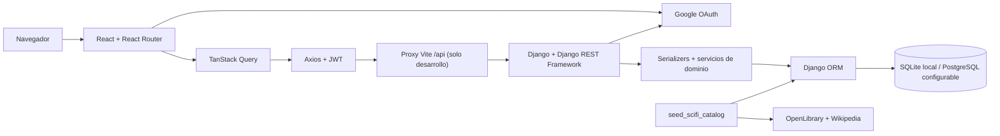
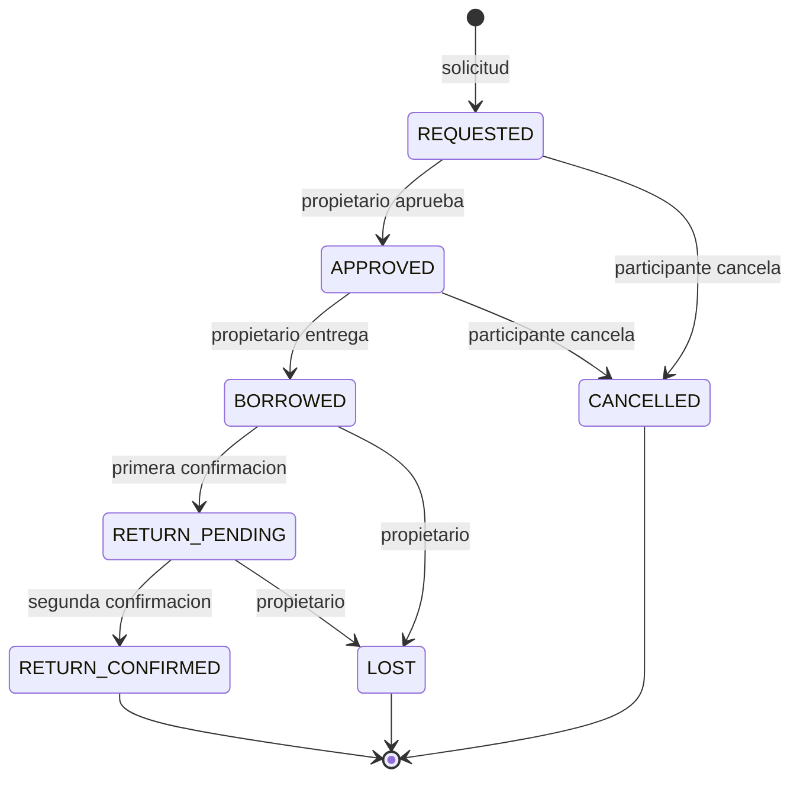

# SDD - Software Design Document

## 1. Objetivo y alcance

MUNDOS DE ACERO OSCURO es una comunidad de literatura de ciencia ficcion.
Permite consultar libros, autores, sagas y premios; publicar resenas y comentarios;
ofrecer ejemplares fisicos; y gestionar prestamos y reservas.

Este documento describe la implementacion del repositorio, no funcionalidades
futuras. El [roadmap](ROADMAP.md) recoge las mejoras pendientes.
El modelo relacional se detalla en [ERD.md](ERD.md) y el contrato HTTP en
[API_SPEC.md](API_SPEC.md).

## 2. Actores

| Actor | Responsabilidades y acceso |
|---|---|
| Visitante | Consultar catalogo, resenas, comentarios y ejemplares ofrecidos; registrarse e iniciar sesion. |
| Usuario autenticado | Editar su perfil y sus publicaciones; gestionar sus ejemplares; solicitar prestamos y reservas; actuar en prestamos en los que participa. |
| Administrador | CRUD del catalogo, moderacion de publicaciones, gestion de usuarios y acceso global a prestamos y reservas. |

El rol de administrador se calcula con `is_staff` o `is_superuser`; no existe
una columna `role`. Ser administrador no permite ejecutar acciones de propietario
o prestatario en prestamos ajenos: los servicios comprueban la participacion.

## 3. Arquitectura y despliegue logico

- **Backend:** Django 5.2, DRF, django-filter, drf-spectacular,
  django-allauth, dj-rest-auth y SimpleJWT.
- **Frontend:** React 19, React Router 7, TanStack Query 5, Axios, Vite 8
  y CSS Modules; interfaz de escritorio con estetica pixel art/CRT.
- **Persistencia:** SQLite por defecto; `DATABASE_URL` permite configurar otro
  motor. PostgreSQL requiere las dependencias de `requirements-postgres.txt`.
- **Integraciones:** Google para identidad; OpenLibrary y Wikipedia para
  enriquecimiento del catalogo; enlaces de compra externos, sin procesamiento
  de pagos.

No hay un proceso de tareas en segundo plano configurado: la importacion del
catalogo se ejecuta mediante un comando de gestion.

## 4. Organizacion del backend

| Modulo en `backend\apps` | Responsabilidad |
|---|---|
| `common` | Permisos, paginacion, limitacion de peticiones, sanitizacion y conversion de errores de borrado protegido a HTTP 409. |
| `users` | Usuario por email, perfil, administracion, registro, Google y enlaces de recuperacion de contrasena hacia la SPA. |
| `authors`, `sagas`, `awards` | CRUD de entidades del catalogo y numero de libros asociado. |
| `books` | Catalogo, filtros, busqueda, estadisticas y enlaces de compra calculados. |
| `reviews` | Resenas de 1 a 5 y comentarios; el autor o un administrador puede modificarlos. |
| `loans` | Ejemplares, prestamos, cola de reservas y servicios de transicion. |
| `scraping` | Catalogo curado, clientes externos e importacion idempotente. |

### Capas y flujo de una peticion

1. Las URLs de `config\urls.py` despachan a vistas de autenticacion o ViewSets.
2. DRF autentica con JWT, aplica permisos, filtros, paginacion y throttles.
3. Los serializers validan entradas, limpian texto y construyen representaciones.
4. Los servicios de prestamos aplican reglas y transacciones.
5. El ORM ejecuta consultas y la base de datos aplica restricciones.

Los ViewSets de catalogo releen el objeto despues de escribir para incluir
anotaciones calculadas. Las consultas de libros usan subconsultas para evitar
que joins entre resenas y ejemplares multipliquen los agregados.

## 5. Reglas de dominio

### Catalogo y publicaciones

- Un libro tiene un autor obligatorio, una saga opcional y varios premios.
- Un ejemplar es propiedad de un usuario y referencia un libro; no se puede
  cambiar ese libro desde la API despues de crear el ejemplar.
- Un usuario puede escribir varias resenas del mismo libro. La puntuacion
  pertenece al intervalo 1-5, tambien restringido en base de datos.
- No se puede mover una resena a otro libro ni un comentario a otra resena.
- Los campos libres que usan `SanitizedCharField` se almacenan como texto
  limpio, no como HTML.

### Prestamos

- No se puede solicitar un ejemplar propio, no ofrecido o ya comprometido.
- `APPROVED`, `BORROWED` y `RETURN_PENDING` comprometen el ejemplar;
  `REQUESTED` no lo bloquea por si mismo.
- Aprobar una solicitud cancela las otras solicitudes pendientes de ese ejemplar.
- La devolucion requiere una confirmacion de cada participante; la segunda
  fija `returned_at`.
- Marcar perdido desactiva `available_for_loan` del ejemplar.
- La API devuelve `allowed_actions` segun el usuario y el estado. Los valores
  llevan guion bajo; las rutas HTTP correspondientes llevan guion medio.
- Los servicios usan `transaction.atomic` y bloqueos `select_for_update`.
  SQLite no ofrece los mismos bloqueos por fila que PostgreSQL.
- La moderacion administrativa por PUT/PATCH solo escribe `status`; no ejecuta
  los efectos de los servicios ni recalcula fechas y confirmaciones.

### Reservas

Una reserva pertenece a un libro, no a un ejemplar. Solo se permite si hay
ejemplares ofrecidos por otros usuarios y ninguno de esos ejemplares esta libre.
Solo puede existir una reserva activa por usuario y libro.

La cola usa `queue_position`. Al pedir un ejemplar libre se comprueba la
prioridad frente al numero de ejemplares libres de otros propietarios. Si el
solicitante tenia reserva, se desactiva y se reordena la cola. Cancelar una
reserva tambien la desactiva y reordena; no elimina su historial.

## 6. Frontend

| Directorio en `frontend\src` | Funcion |
|---|---|
| `pages`, `layouts`, `components` | Paginas, estructura visual y controles reutilizables. |
| `features` | Autenticacion, catalogo, resenas, prestamos y administracion. |
| `services` | Axios, almacenamiento de tokens y clientes REST. |
| `hooks` | Queries, mutaciones, invalidacion de recursos y utilidades de interfaz. |
| `styles` | Estilos globales y apariencia CRT. |

**Rutas publicas:** `/`, `/books`, `/books/:id`, `/authors`,
`/authors/:id`, `/sagas`, `/sagas/:id`, `/awards`, `/login`, `/register`,
`/forgot-password` y `/reset-password/:uid/:token`.
`/profile` requiere sesion y `/admin` requiere administrador.
`/home` redirige a `/`; las rutas desconocidas muestran la pagina de error.
Estas protecciones de interfaz no sustituyen los permisos del backend.

TanStack Query mantiene las consultas frescas durante 30 segundos, no refresca
al enfocar la ventana y reintenta errores HTTP 5xx hasta dos veces.
Las mutaciones invalidan el recurso y sus dependencias: por ejemplo, un
prestamo invalida libros, ejemplares, reservas y usuarios.

## 7. Identidad y seguridad

- El login local usa email y contrasena. Google usa un codigo OAuth intercambiado
  por el backend. La recuperacion de contrasena enlaza a la ruta de la SPA.
- Los access tokens duran 30 minutos y los refresh tokens 7 dias por defecto.
  Los refresh rotan y los anteriores pasan a blacklist.
- Axios almacena ambos tokens en `localStorage` y adjunta el access token.
  Varios errores 401 concurrentes comparten un unico refresco; si falla, se
  limpia la sesion y la cache de consultas.
- El almacenamiento en `localStorage` implica exposicion a JavaScript del
  mismo origen; no hay una cookie HttpOnly de refresh configurada actualmente.
- La API de negocio usa autenticacion JWT; Django Admin usa su propia sesion
  y proteccion CSRF.
- Hay throttles anonimos, por usuario, de escritura y de autenticacion.
  No sustituyen controles de red ni garantizan limites distribuidos.
- La configuracion de produccion desactiva debug y configura HTTPS, cookies
  seguras, HSTS y cabeceras. No debe utilizarse `runserver` en produccion.
- Los dumps SQL contienen datos privados y no deben versionarse.

## 8. Persistencia y busqueda

El esquema y las restricciones evolucionan con migraciones de Django.
Las medias, contadores, disponibilidad y acciones permitidas son calculados;
no son columnas de las entidades del dominio.

La busqueda de libros usa `q`: SQLite aplica `icontains` por termino sobre
titulo, autor, ISBN y sinopsis; PostgreSQL usa `SearchVector`, `SearchQuery`
y `SearchRank` con configuracion `simple`. Las estrategias no tienen semantica
identica: PostgreSQL interpreta busquedas web y ordena por relevancia.

El importador consulta fuentes externas y usa ISBN o titulo/autor para localizar
libros existentes. Completa campos vacios sin sobrescribir los ya informados y
registra fallos por libro para continuar con los siguientes.

## 9. Operacion y validacion

- Arranque local: [backend](BACKEND_LOCAL.md) y [frontend](FRONTEND_LOCAL.md).
- OpenAPI: `/api/schema/`; Swagger: `/api/docs/`; ReDoc: `/api/redoc/`.
- Backend: desde `backend`, `.\.venv\Scripts\python.exe -m pytest`.
  La configuracion exige cobertura minima del 80 %; el entorno de tests usa
  SQLite en memoria, correo en memoria y un hasher rapido exclusivo de tests.
- Frontend: desde `frontend`, `npm test` y `npm run test:coverage`.
  Vitest usa jsdom y Testing Library.
- Build de la SPA: `npm run build`; publica `dist` con fallback a `index.html`.
  El proxy de Vite solo existe en desarrollo: produccion necesita un proxy
  propio o `VITE_API_URL` con el origen publico de Django.

No se fijan cifras de tests o registros aqui: cambian con el repositorio y no
forman parte del contrato de diseno.

## 10. Fuentes de implementacion

- [URLs](../backend/config/urls.py) y [configuracion](../backend/config/settings/base.py).
- [Dominio de prestamos](../backend/apps/loans/services.py) y
  [modelos](../backend/apps/loans/models.py).
- [Buscador](../backend/apps/books/search.py) e
  [importador](../backend/apps/scraping/importer.py).
- [Rutas SPA](../frontend/src/App.jsx), [cliente HTTP](../frontend/src/services/api.js)
  y [cache e invalidacion](../frontend/src/hooks/useResources.js).
